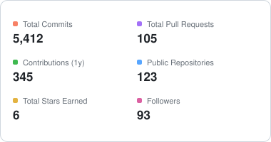
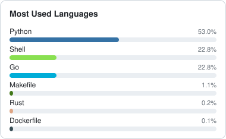
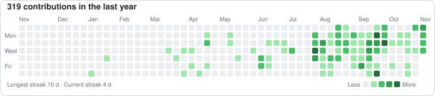

# Zhiquan Yu · Heisenberg

**Cloud Native Engineer / 容器 PaaS · Go · Kubernetes**

📍 Beijing, China · 🌐 [Blog](https://yuzhiquan.github.io) · 📖 [知乎](https://www.zhihu.com/people/hanniba) · 💼 [LinkedIn](https://www.linkedin.com/in/zhiquan-yu-7a701b97/) · 🐦 [@ZhiquanYu](https://twitter.com/ZhiquanYu)

---

## 👨‍💻 About me

- 📫 Open to new opportunities: cloud-native engineer / architect roles
- 🔭 Currently building **container PaaS platforms / cluster-wide Service Mesh rollout / multi-cloud infrastructure**
- 🌱 Focused on: **Kubernetes scheduling & elasticity, Service Mesh & multi-cluster, container networking, GPU scheduling & isolation, cloud-native observability**
- 👯 Community: member of `@kubernetes` / `@kubernetes-sigs`, reviewer in `sig-instrumentation` and `wg-structured-logging`
- 💬 Happy to talk about: Go, K8s controllers & Operators, scheduler extensions, structured logging, metrics/tracing

<b>🇨🇳 中文简介 · 点击展开</b>

- 🔭 当前在做 **容器 PaaS 平台 / Service Mesh 全集群落地 / 多云基础设施**
- 🌱 持续投入：**Kubernetes 调度与弹性、Service Mesh 与多集群、容器网络、GPU 算力调度与隔离、云原生可观测性**
- 👯 社区参与：`@kubernetes` / `@kubernetes-sigs` member，`sig-instrumentation`、`wg-structured-logging` reviewer
- 💬 乐于交流：Go、K8s 控制器与 Operator、调度器扩展、Structured Logging、Metrics/Tracing
- 📫 找工作：云原生工程师 / 架构师方向，**Open to new opportunity**

## 🛠 Tech stack

**Languages**

  
  
  

**Cloud Native & Platform**

  
  
  
  
  
  
  
  

**Infra · Cloud · Networking**

  
  
  
  
  
  

**AI Infra**

  
  
  
  

## 📊 GitHub stats

  
  

  

## 🔀 Recent pull requests

<!--START_SECTION:prs-->
- [#2136](https://github.com/kubernetes-sigs/agent-sandbox/pull/2136) feat(warmpool): per-pool readiness grace period override · `kubernetes-sigs/agent-sandbox` · _open_
- [#2137](https://github.com/kubernetes-sigs/agent-sandbox/pull/2137) docs(agents): require roadmap updates in the PR that changes a roadmap f... · `kubernetes-sigs/agent-sandbox` · _open_
- [#139923](https://github.com/kubernetes/kubernetes/pull/139923) Degrade gracefully when etcd Maintenance.Status is PermissionDenied · `kubernetes/kubernetes` · _open_
- [#140308](https://github.com/kubernetes/kubernetes/pull/140308) scheduler: treat empty topology label value as invalid TAS domain · `kubernetes/kubernetes` · _merged_
- [#140097](https://github.com/kubernetes/kubernetes/pull/140097) WIP: test/integration/dra: add gang+DRA allocation conflict reproducer · `kubernetes/kubernetes` · _open_
- [#1439](https://github.com/kubernetes-sigs/agent-sandbox/pull/1439) refactor(warmpool): read mirrored PodScheduled instead of fetching the P... · `kubernetes-sigs/agent-sandbox` · _merged_
- [#1605](https://github.com/kubernetes-sigs/agent-sandbox/pull/1605) feat(clients/ts): support automatic sandbox expiration · `kubernetes-sigs/agent-sandbox` · _merged_
- [#140143](https://github.com/kubernetes/kubernetes/pull/140143) scheduler: add podgroup_cache_missed_events_total metric · `kubernetes/kubernetes` · _closed_
- [#1339](https://github.com/kubernetes-sigs/agent-sandbox/pull/1339) feat(mcp): add /healthz and /readyz probe endpoints · `kubernetes-sigs/agent-sandbox` · _merged_
- [#1329](https://github.com/kubernetes-sigs/agent-sandbox/pull/1329) feat(mcp): add list_files and file_exists tools · `kubernetes-sigs/agent-sandbox` · _merged_
<!--END_SECTION:prs-->

## 🧠 AI Infra

📦 [ai-infra-book-analysis](https://github.com/yuzhiquan/ai-infra-book-analysis/tree/main/beginner-series) · [beginner-series](https://github.com/yuzhiquan/ai-infra-book-analysis/tree/main/beginner-series) + [blogs](https://github.com/yuzhiquan/ai-infra-book-analysis/tree/main/blogs) 🔒 · [AI-INFRA](https://github.com/yuzhiquan/AI-INFRA)

<!--START_SECTION:aiinfra-->
- [在 Kubernetes 上跑通大模型训练与推理（面向初学者）](https://github.com/yuzhiquan/ai-infra-book-analysis/blob/main/beginner-series/README.md) · 2026-09-16 · `入门系列`
- [第 0 篇：这个系列讲什么，不讲什么](https://github.com/yuzhiquan/ai-infra-book-analysis/blob/main/beginner-series/00-scope-and-boundaries.zh-CN.md) · 2026-09-16 · `入门系列`
- [第 1 篇：一次推理请求在 Kubernetes 上经过什么](https://github.com/yuzhiquan/ai-infra-book-analysis/blob/main/beginner-series/01-request-path.zh-CN.md) · 2026-09-16 · `入门系列`
- [第 2 篇：容量账 —— 先估一个数，再去集群里找它](https://github.com/yuzhiquan/ai-infra-book-analysis/blob/main/beginner-series/02-capacity-accounting.zh-CN.md) · 2026-09-16 · `入门系列`
- [第 3 篇：数据 —— 为什么 tokenize 完还要定长](https://github.com/yuzhiquan/ai-infra-book-analysis/blob/main/beginner-series/03-data-processing.zh-CN.md) · 2026-09-16 · `入门系列`
- [第 4 篇：训练 —— N 张卡怎么变成一个训练组](https://github.com/yuzhiquan/ai-infra-book-analysis/blob/main/beginner-series/04-training.zh-CN.md) · 2026-09-16 · `入门系列`

<b>📂 展开其余 12 篇</b>（共 18 篇）

- [第 5 篇：批量推理 —— 同一个引擎，相反的目标](https://github.com/yuzhiquan/ai-infra-book-analysis/blob/main/beginner-series/05-batch-inference.zh-CN.md) · 2026-09-16 · `入门系列`
- [第 6 篇：在线服务 —— 让流量只打到真正就绪的实例](https://github.com/yuzhiquan/ai-infra-book-analysis/blob/main/beginner-series/06-online-serving.zh-CN.md) · 2026-09-16 · `入门系列`
- [AI Infra 与云原生技术博客 / AI Infrastructure and Cloud Native Systems](https://github.com/yuzhiquan/ai-infra-book-analysis/blob/main/blogs/README.md) · 2026-09-14 · `博客`
- [从 HTTP 请求到 token：K8s 工程师需要理解的推理服务生命周期](https://github.com/yuzhiquan/ai-infra-book-analysis/blob/main/blogs/01-from-http-to-tokens.zh-CN.md) · 2026-09-14 · `博客`
- [Pod 已经 Running，模型为什么还没 Ready？](https://github.com/yuzhiquan/ai-infra-book-analysis/blob/main/blogs/02-model-startup.zh-CN.md) · 2026-09-14 · `博客`
- [为什么同样的 QPS，会压垮你的模型服务？](https://github.com/yuzhiquan/ai-infra-book-analysis/blob/main/blogs/03-workload-and-capacity.zh-CN.md) · 2026-09-14 · `博客`
- [大模型服务的 HPA 应该看什么？](https://github.com/yuzhiquan/ai-infra-book-analysis/blob/main/blogs/04-inference-autoscaling.zh-CN.md) · 2026-09-14 · `博客`
- [滚动发布时，正在生成的回答怎么办？](https://github.com/yuzhiquan/ai-infra-book-analysis/blob/main/blogs/05-streaming-rollouts.zh-CN.md) · 2026-09-14 · `博客`
- [负载均衡遇上 KV Cache：请求应该发给谁？](https://github.com/yuzhiquan/ai-infra-book-analysis/blob/main/blogs/06-kv-aware-routing.zh-CN.md) · 2026-09-14 · `博客`
- [从 K8s Job 到分布式训练：worker、状态与恢复](https://github.com/yuzhiquan/ai-infra-book-analysis/blob/main/blogs/07-training-on-kubernetes.zh-CN.md) · 2026-09-14 · `博客`
- [从数据到在线生成：用 Kubernetes、Ray、PyTorch 与 vLLM 跑通大模型链路](https://github.com/yuzhiquan/ai-infra-book-analysis/blob/main/blogs/08-end-to-end-llm-pipeline.zh-CN.md) · 2026-09-14 · `博客`
- [Kubernetes + Ray + PyTorch + vLLM pipeline](https://github.com/yuzhiquan/ai-infra-book-analysis/blob/main/blogs/examples/08-llm-pipeline/README.md) · 2026-09-14 · `博客`

<!--END_SECTION:aiinfra-->

## 🤖 AI Agent

📦 🔒 [MiniAgent-tutorial](https://github.com/yuzhiquan/MiniAgent-tutorial) · [agent-from-scratch](https://github.com/yuzhiquan/agent-from-scratch)

<!--START_SECTION:aiagent-->
- [第七章：当 Agent 遇上知识库——RAG 是什么，怎么用 Mini-Agent 的思路来理解它](https://github.com/yuzhiquan/MiniAgent-tutorial/blob/main/07_rag.md) · 2026-05-11 · `MiniAgent 源码`
- [Mini-Agent 源码解析系列文章](https://github.com/yuzhiquan/MiniAgent-tutorial/blob/main/README.md) · 2026-04-21 · `MiniAgent 源码`
- [第零章：什么是 AI Agent？从零认识 Mini-Agent](https://github.com/yuzhiquan/MiniAgent-tutorial/blob/main/00_overview.md) · 2026-04-21 · `MiniAgent 源码`
- [第一章：心脏地带——Agent 执行循环](https://github.com/yuzhiquan/MiniAgent-tutorial/blob/main/01_agent_loop.md) · 2026-04-21 · `MiniAgent 源码`
- [第二章：Agent 的双手——工具系统设计](https://github.com/yuzhiquan/MiniAgent-tutorial/blob/main/02_tools_system.md) · 2026-04-21 · `MiniAgent 源码`
- [第三章：Agent 的大脑接口——LLM 客户端与多 Provider 支持](https://github.com/yuzhiquan/MiniAgent-tutorial/blob/main/03_llm_client.md) · 2026-04-21 · `MiniAgent 源码`

<b>📂 展开其余 10 篇</b>（共 16 篇）

- [第四章：记忆与遗忘——上下文管理与自动摘要](https://github.com/yuzhiquan/MiniAgent-tutorial/blob/main/04_context_management.md) · 2026-04-21 · `MiniAgent 源码`
- [第五章：更多技能——Skills 系统与 MCP 集成](https://github.com/yuzhiquan/MiniAgent-tutorial/blob/main/05_skills_mcp.md) · 2026-04-21 · `MiniAgent 源码`
- [第六章：门面担当——CLI 设计与配置管理](https://github.com/yuzhiquan/MiniAgent-tutorial/blob/main/06_cli_config.md) · 2026-04-21 · `MiniAgent 源码`
- [Agent 开发系列教程](https://github.com/yuzhiquan/agent-from-scratch/blob/main/README.md) · 2026-04-20 · `从零实现`
- [第一篇：AI Agent 是什么？为什么选择 LangGraph？](https://github.com/yuzhiquan/agent-from-scratch/blob/main/01_introduction.md) · 2026-04-20 · `从零实现`
- [第二篇：LangGraph 核心概念——从零理解 Agent 框架](https://github.com/yuzhiquan/agent-from-scratch/blob/main/02_langgraph_101.md) · 2026-04-20 · `从零实现`
- [第三篇：构建邮件分类与回复 Agent](https://github.com/yuzhiquan/agent-from-scratch/blob/main/03_email_assistant.md) · 2026-04-20 · `从零实现`
- [第四篇：人机协作（Human-in-the-Loop）——让 Agent 更安全可控](https://github.com/yuzhiquan/agent-from-scratch/blob/main/04_hitl.md) · 2026-04-20 · `从零实现`
- [第五篇：记忆与自适应学习——让 Agent 越用越好](https://github.com/yuzhiquan/agent-from-scratch/blob/main/05_memory.md) · 2026-04-20 · `从零实现`
- [第六篇：测试与评估——如何知道 Agent 表现好不好？](https://github.com/yuzhiquan/agent-from-scratch/blob/main/06_evaluation.md) · 2026-04-20 · `从零实现`

<!--END_SECTION:aiagent-->

## 🧩 LLM

📦 [llm-starter · 精读笔记](https://github.com/yuzhiquan/llm-starter/tree/main/精读笔记)

<!--START_SECTION:llm-->
- [第 1 篇精读｜猜下一个词](https://github.com/yuzhiquan/llm-starter/blob/main/%E7%B2%BE%E8%AF%BB%E7%AC%94%E8%AE%B0/01-%E7%8C%9C%E4%B8%8B%E4%B8%80%E4%B8%AA%E8%AF%8D.md) · 2026-11-03 · `精读笔记`
- [第 2 篇精读｜Token——大模型眼中的"字"长什么样](https://github.com/yuzhiquan/llm-starter/blob/main/%E7%B2%BE%E8%AF%BB%E7%AC%94%E8%AE%B0/02-Token.md) · 2026-11-03 · `精读笔记`
- [第 3 篇精读｜Embedding——把文字变成数学](https://github.com/yuzhiquan/llm-starter/blob/main/%E7%B2%BE%E8%AF%BB%E7%AC%94%E8%AE%B0/03-Embedding.md) · 2026-11-03 · `精读笔记`
- [第 4 篇精读｜Attention —— 大模型的「阅读理解」机制](https://github.com/yuzhiquan/llm-starter/blob/main/%E7%B2%BE%E8%AF%BB%E7%AC%94%E8%AE%B0/04-Attention.md) · 2026-11-03 · `精读笔记`
- [第 5 篇精读｜Transformer 全景：积木怎么搭成大厦](https://github.com/yuzhiquan/llm-starter/blob/main/%E7%B2%BE%E8%AF%BB%E7%AC%94%E8%AE%B0/05-Transformer.md) · 2026-11-03 · `精读笔记`
- [第 6 篇精读｜训练：70 亿个参数是怎么"学"出来的](https://github.com/yuzhiquan/llm-starter/blob/main/%E7%B2%BE%E8%AF%BB%E7%AC%94%E8%AE%B0/06-%E8%AE%AD%E7%BB%83.md) · 2026-11-03 · `精读笔记`

<b>📂 展开其余 10 篇</b>（共 16 篇）

- [第 7 篇精读｜推理与 KV Cache：按下回车后的这一秒](https://github.com/yuzhiquan/llm-starter/blob/main/%E7%B2%BE%E8%AF%BB%E7%AC%94%E8%AE%B0/07-%E6%8E%A8%E7%90%86%E4%B8%8EKV-Cache.md) · 2026-11-03 · `精读笔记`
- [第 8 篇精读｜上下文窗口——大模型的"工作记忆"到底有多大？](https://github.com/yuzhiquan/llm-starter/blob/main/%E7%B2%BE%E8%AF%BB%E7%AC%94%E8%AE%B0/08-%E4%B8%8A%E4%B8%8B%E6%96%87%E7%AA%97%E5%8F%A3.md) · 2026-11-03 · `精读笔记`
- [第 9 篇精读｜Scaling Law——为什么"大力出奇迹"有效](https://github.com/yuzhiquan/llm-starter/blob/main/%E7%B2%BE%E8%AF%BB%E7%AC%94%E8%AE%B0/09-Scaling-Law.md) · 2026-11-03 · `精读笔记`
- [第 10 篇精读｜从大模型到 Agent——下一个词预测如何长出手脚](https://github.com/yuzhiquan/llm-starter/blob/main/%E7%B2%BE%E8%AF%BB%E7%AC%94%E8%AE%B0/10-Agent.md) · 2026-11-03 · `精读笔记`
- [第 11 篇精读｜多模态：大模型是怎么“看懂”图片的](https://github.com/yuzhiquan/llm-starter/blob/main/%E7%B2%BE%E8%AF%BB%E7%AC%94%E8%AE%B0/11-%E5%A4%9A%E6%A8%A1%E6%80%81.md) · 2026-11-03 · `精读笔记`
- [第 12 篇精读｜GPU：为什么大模型离不开它](https://github.com/yuzhiquan/llm-starter/blob/main/%E7%B2%BE%E8%AF%BB%E7%AC%94%E8%AE%B0/12-GPU.md) · 2026-11-03 · `精读笔记`
- [第 13 篇精读｜Token 计费：为什么输出比输入贵](https://github.com/yuzhiquan/llm-starter/blob/main/%E7%B2%BE%E8%AF%BB%E7%AC%94%E8%AE%B0/13-Token%E8%AE%A1%E8%B4%B9.md) · 2026-11-03 · `精读笔记`
- [第 14 篇精读｜思考模式：模型只是先给自己打了份草稿](https://github.com/yuzhiquan/llm-starter/blob/main/%E7%B2%BE%E8%AF%BB%E7%AC%94%E8%AE%B0/14-%E6%80%9D%E8%80%83%E6%A8%A1%E5%BC%8F.md) · 2026-11-03 · `精读笔记`
- [第 15 篇精读｜MoE：把"知道多少"和"算得多快"拆开卖](https://github.com/yuzhiquan/llm-starter/blob/main/%E7%B2%BE%E8%AF%BB%E7%AC%94%E8%AE%B0/15-MoE.md) · 2026-11-03 · `精读笔记`
- [第 16 篇精读｜算子：大模型最小的施工单位和最大的隐藏成本](https://github.com/yuzhiquan/llm-starter/blob/main/%E7%B2%BE%E8%AF%BB%E7%AC%94%E8%AE%B0/16-%E7%AE%97%E5%AD%90.md) · 2026-11-03 · `精读笔记`

<!--END_SECTION:llm-->

Last updated: <!--START_SECTION:updated-->2026-11-09 06:57 UTC<!--END_SECTION:updated-->

---

本页动态区块由 GitHub Actions 每 30 分钟自动更新 · 源码见 <a href=".github/workflows/update-readme.yml">workflow</a>

